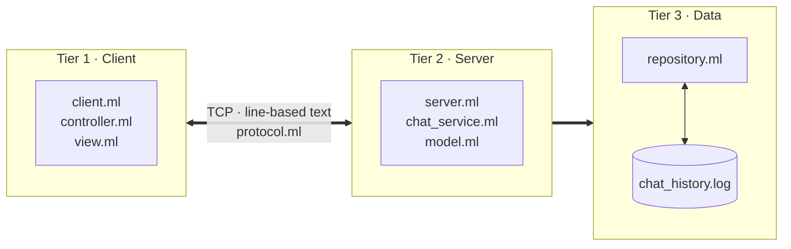

# OCaml Chat

[](https://github.com/limpst/ocaml-chat/actions/workflows/build.yml)
[](https://github.com/limpst/ocaml-chat/actions/workflows/docs.yml)


[한국어](README.md) · **English**

A multi-user chat program over TCP sockets, written in OCaml.
It follows a **3-tier architecture** with the **MVC pattern**, and all message handling happens on the server.
It depends on nothing beyond `unix` and `threads` from the standard distribution.

## At a glance



| Tier | Folder | Role |
|---|---|---|
| 1. Presentation | `src/client` | Parse keyboard input (Controller), print server responses (View) |
| 2. Business logic | `src/server` | Handle requests, keep room/session state (Model), broadcast |
| 3. Data | `src/data` | Persist messages to `chat_history.log` |
| Shared | `src/shared` | Message type, wire protocol, string and lock helpers |

## Quick start

```powershell
# Windows
.\build.ps1                          # builds server / client into bin\
.\run-server.ps1                     # server (default port 9000)
.\run-client.ps1                     # client — run it in several terminals
.\run-client.ps1 192.168.0.10 9000   # connect to a server on another PC
```

```sh
# Linux / macOS
./build.sh
./bin/server.exe 9000
./bin/client.exe 127.0.0.1 9000
```

> Some antivirus tools flag a freshly compiled `server.exe`, so `run-server.ps1` runs the bytecode build (`ocamlrun bin\server.byte`).

Requirements: OCaml 5.x (opam). On Windows: `winget install OCaml.opam` → `opam init`.

## Commands

| Input | Action |
|---|---|
| `/nick NAME` | Change nickname (letters, digits, `_`, `-`; up to 16 chars; must be unique) |
| `/who` | List users online |
| `/history` | Show the last 20 messages |
| `/quit` | Quit |
| anything else | Send a chat message |

## Example session

```
connected to 127.0.0.1:9000
*** Welcome, guest1! Commands: /nick NAME, /who, /history, /quit
*** guest1 is now known as alice
*** guest2 joined the chat
*** guest2 is now known as bob
[03:15:03] alice: Hello bob!
[03:15:03] bob: Hi alice, OCaml chat works
*** online (2): alice, bob
```

## Wire protocol

One line = one message, fields separated by a tab.

| Direction | Format |
|---|---|
| Client → Server | `SAY<TAB>text` · `NICK<TAB>name` · `WHO` · `HIST` · `QUIT` |
| Server → Client | `MSG<TAB>time<TAB>author<TAB>text` · `SYS<TAB>text` · `USERS<TAB>a,b,c` · `ERR<TAB>text` |

## Testing and CI

- `tests/smoke.sh` starts the server, drives a client with scripted input and checks its output.
- `build.yml` builds on Ubuntu and Windows and runs the smoke test on every push to `main` and every PR.
- `docs.yml` renders every Mermaid diagram and checks links whenever Markdown changes.

## Detailed docs (Korean)

| Doc | Contents |
|---|---|
| [Architecture](docs/architecture.md) | Tiers, module dependencies, data model, connection states |
| [Request flows](docs/flows.md) | Chat, connection lifecycle, nickname change, history sequences |
| [Concurrency](docs/concurrency.md) | Server/client threads, the three locks, broadcast strategy |
| [Protocol](docs/protocol.md) | Request/response formats, storage format |
| [Build · CI](docs/build.md) | Build scripts and order, smoke test, GitHub Actions |
