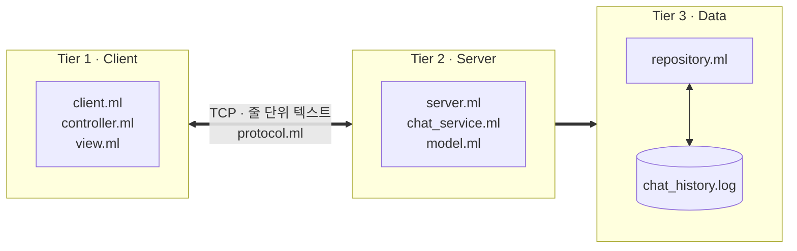

# OCaml Chat

[](https://github.com/limpst/ocaml-chat/actions/workflows/build.yml)
[](https://github.com/limpst/ocaml-chat/actions/workflows/docs.yml)


**한국어** · [English](README.en.md)

OCaml로 작성한 TCP 소켓 기반 멀티 유저 채팅 프로그램입니다.
**3-Tier 아키텍처**와 **MVC 패턴**으로 구성되어 있으며, 메시지 처리는 모두 서버에서 이루어집니다.
표준 배포판의 `unix`, `threads` 외에는 의존성이 없습니다.

## 한눈에 보기



## 빠른 시작

```powershell
# Windows
.\build.ps1                          # bin\ 에 server / client 생성
.\run-server.ps1                     # 서버 (기본 포트 9000)
.\run-client.ps1                     # 클라이언트 — 터미널 여러 개에서 실행
.\run-client.ps1 192.168.0.10 9000   # 다른 PC의 서버에 접속
```

```sh
# Linux / macOS
./build.sh
./bin/server.exe 9000
./bin/client.exe 127.0.0.1 9000
```

> 일부 백신이 새로 컴파일된 `server.exe`를 오탐할 수 있어 `run-server.ps1`은 바이트코드(`ocamlrun bin\server.byte`)로 실행합니다.

요구 사항: OCaml 5.x (opam). 자세한 내용은 [빌드 · CI](docs/build.md)를 보세요.

## 명령어

| 입력 | 동작 |
|---|---|
| `/nick NAME` | 닉네임 변경 (영문/숫자/`_`/`-`, 최대 16자, 중복 불가) |
| `/who` | 접속자 목록 |
| `/history` | 최근 메시지 20개 |
| `/quit` | 종료 |
| 그 외 | 채팅 메시지 전송 |

## 실행 예

```
connected to 127.0.0.1:9000
*** Welcome, guest1! Commands: /nick NAME, /who, /history, /quit
*** guest1 is now known as alice
*** guest2 joined the chat
*** guest2 is now known as bob
[03:15:03] alice: Hello bob!
[03:15:03] bob: Hi alice, OCaml chat works
*** online (2): alice, bob
```

## 문서

| 문서 | 내용 |
|---|---|
| [아키텍처](docs/architecture.md) | 3-Tier 계층 구조, 모듈 의존 관계, 데이터 모델, 접속 상태 |
| [요청 흐름](docs/flows.md) | 채팅 · 연결 수명 주기 · 닉네임 변경 · 대화 기록 시퀀스 |
| [동시성](docs/concurrency.md) | 서버/클라이언트 스레드 구성, 잠금 3종, 브로드캐스트 전략 |
| [프로토콜](docs/protocol.md) | 요청/응답 형식, 저장 파일 형식, 직접 접속해 보기 |
| [빌드 · CI](docs/build.md) | 빌드 스크립트와 순서, 스모크 테스트, GitHub Actions |

## 폴더 구조

```
src/
  shared/              서버·클라이언트 공용 (sync, text, message, protocol)
  data/                Tier 3 — repository.ml (메시지 영속화)
  server/              Tier 2 — model.ml · chat_service.ml · server.ml
  client/              Tier 1 — view.ml · controller.ml · client.ml
docs/                  상세 문서 (Mermaid 다이어그램)
tests/smoke.sh         서버 + 클라이언트 종단 간 스모크 테스트
build.ps1 / build.sh   빌드 스크립트 (Windows / Linux·macOS) → bin/
run-server.ps1         서버 실행
run-client.ps1         클라이언트 실행
.github/workflows/     CI — build.yml (빌드·테스트), docs.yml (문서 검사)
```
