# OCaml Chat


OCaml로 작성한 TCP 소켓 기반 멀티 유저 채팅 프로그램입니다.
**3-Tier 아키텍처**와 **MVC 패턴**으로 구성되어 있으며, 메시지 처리는 모두 서버에서 이루어집니다.

## 목차

- [아키텍처](#아키텍처) — 계층 구조 · 모듈 의존 관계 · 데이터 모델 · 접속 상태
- [스레드와 동시성](#스레드와-동시성)
- [폴더 구조](#폴더-구조)
- [요청 처리 흐름](#요청-처리-흐름) — 채팅 · 연결 수명 주기 · 닉네임 변경 · 히스토리
- [통신 프로토콜](#통신-프로토콜)
- [요구 사항](#요구-사항) · [빌드](#빌드) · [실행](#실행) · [명령어](#명령어) · [실행 예](#실행-예)

## 아키텍처

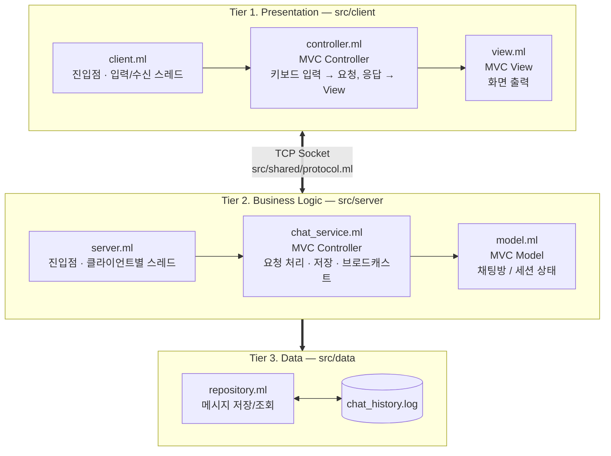

### 모듈 의존 관계

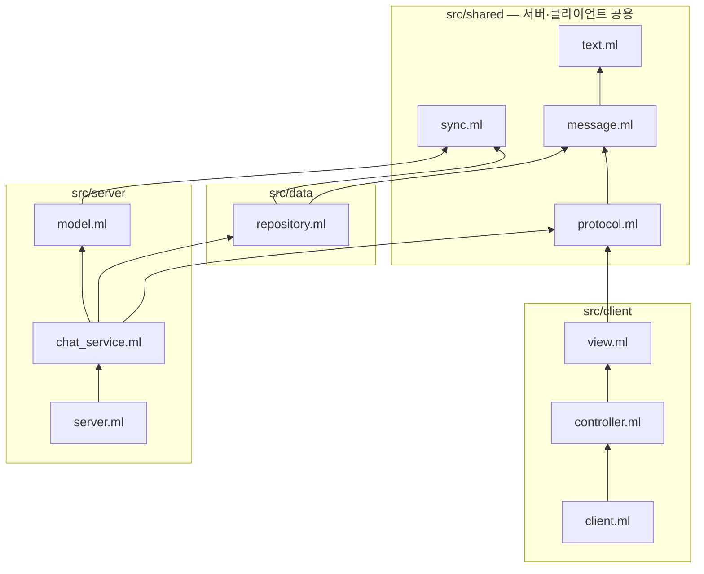

> 화살표는 "사용한다" 방향입니다. 빌드 순서는 아래(shared) → 위(server / client)입니다.

### 데이터 모델

서버 상태(`model.ml`)와 공용 메시지 타입(`message.ml`)입니다.

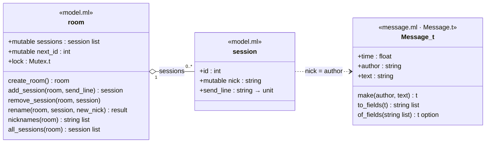

| 규칙 | 내용 |
|---|---|
| 기본 닉네임 | 접속 순서대로 `guest1`, `guest2`, … (`next_id`) |
| 닉네임 형식 | 1~16자, `a-z A-Z 0-9 _ -` |
| 닉네임 중복 | 다른 세션이 쓰는 이름이면 `ERR⇥nickname already in use` |

### 클라이언트 접속 상태

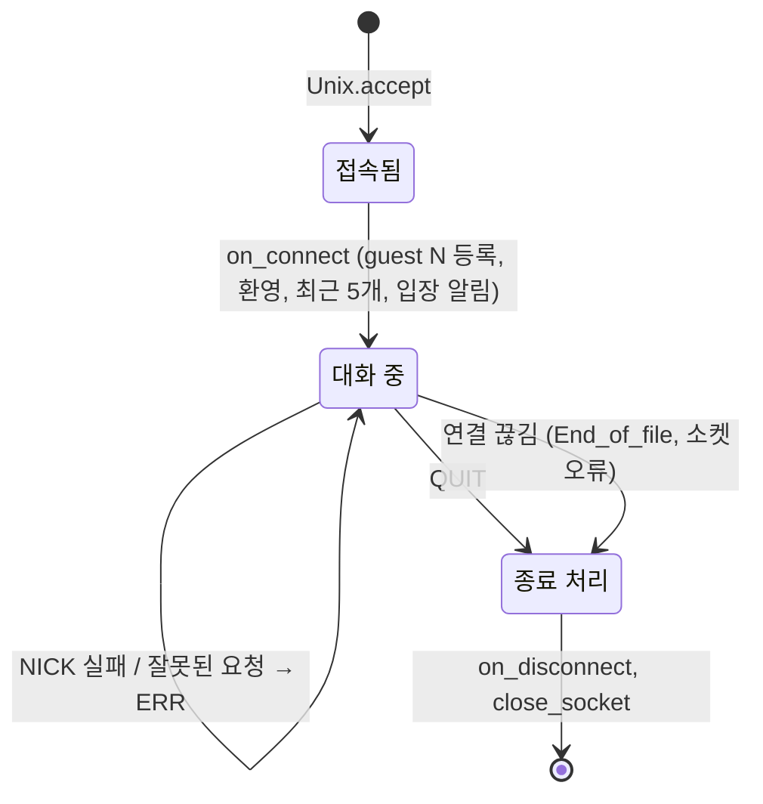

## 스레드와 동시성

서버는 접속마다 스레드를 하나씩 띄우고, 공유 자원은 `Sync.with_lock`(예외가 나도 반드시 잠금 해제)으로 보호합니다.

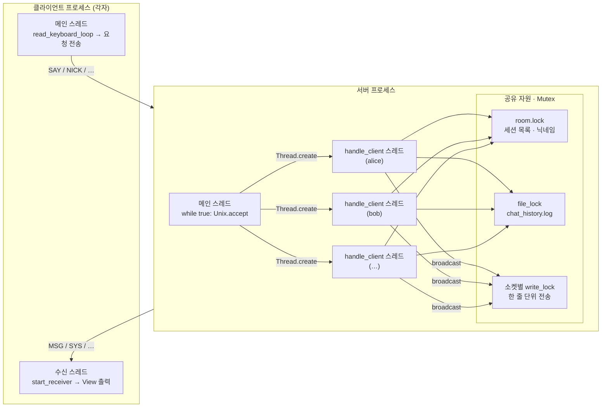

| 잠금 | 위치 | 보호 대상 | 이유 |
|---|---|---|---|
| `room.lock` | `model.ml` | 세션 목록, 닉네임, `next_id` | 동시 접속·닉 변경 시 목록 일관성 |
| `file_lock` | `repository.ml` | `chat_history.log` 쓰기/읽기 | 저장 중 읽기 · 줄 섞임 방지 |
| `write_lock` | `server.ml` (소켓마다) | 소켓 출력 채널 | 여러 스레드의 broadcast가 한 소켓에 겹쳐 쓰는 것 방지 |

> `broadcast`는 `all_sessions`로 세션 목록 **복사본**만 잠금 안에서 얻고, 실제 전송은 잠금 밖에서 합니다. 느린 클라이언트 하나가 채팅방 전체를 막지 않도록 하기 위해서입니다.

## 폴더 구조

```
src/
  shared/              서버·클라이언트 공용
    sync.ml            스레드 잠금 도우미 (with_lock)
    text.ml            문자열 도우미 (탭 필드 분리/결합, BOM·\r 제거)
    message.ml         채팅 메시지 타입 (공용 Model 데이터)
    protocol.ml        소켓 통신 규약 (request / response 인코딩·디코딩)
  data/
    repository.ml      Tier 3 — 메시지 영속화
  server/
    model.ml           Tier 2 — MVC Model
    chat_service.ml    Tier 2 — MVC Controller (메시지 처리)
    server.ml          Tier 2 — 서버 진입점
  client/
    view.ml            Tier 1 — MVC View
    controller.ml      Tier 1 — MVC Controller
    client.ml          Tier 1 — 클라이언트 진입점
build.ps1              빌드 스크립트 → bin/
run-server.ps1         서버 실행
run-client.ps1         클라이언트 실행
```

## 요청 처리 흐름

키보드로 `hello`를 입력했을 때의 흐름입니다.

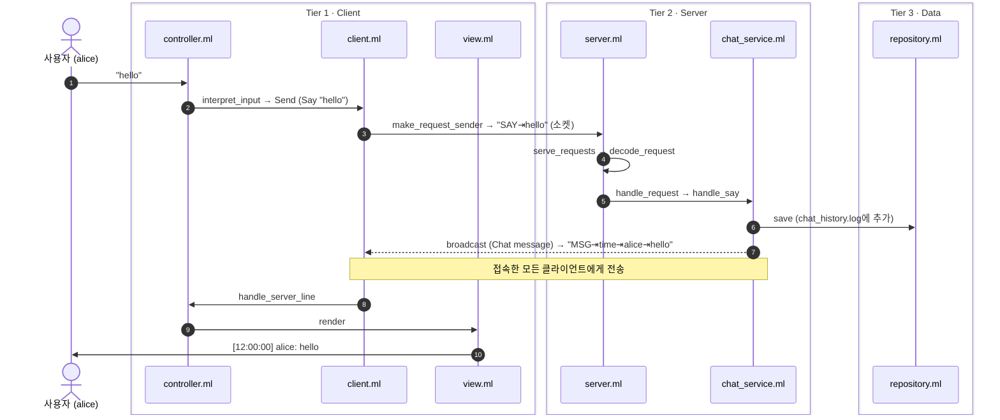

### 클라이언트 연결 수명 주기 (서버)

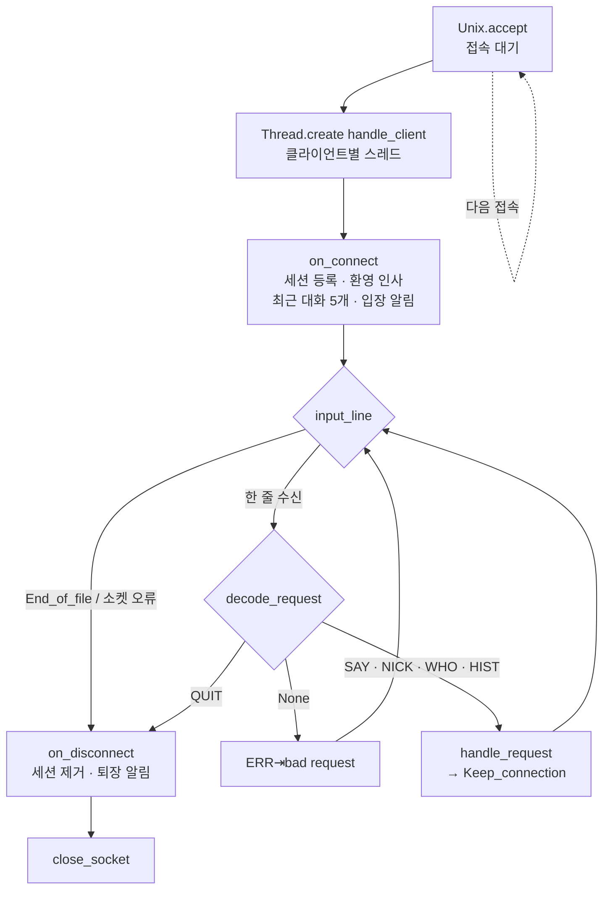

### 닉네임 변경 (`/nick`)

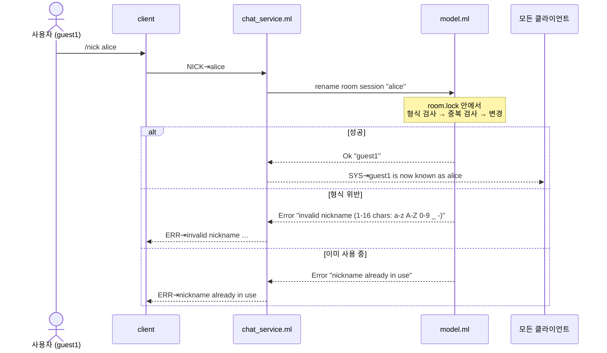

### 대화 기록 (입장 시 · `/history`)

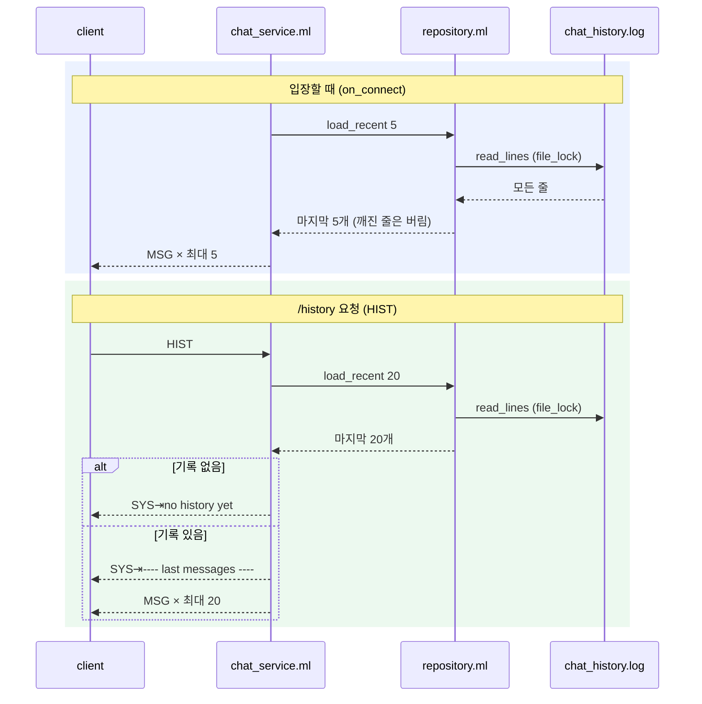

저장 형식(`chat_history.log`)은 프로토콜의 `MSG` 필드와 같습니다: `time⇥author⇥text` (한 줄에 하나)

## 통신 프로토콜

한 줄 = 메시지 하나, 필드 구분자 = 탭(`⇥`)

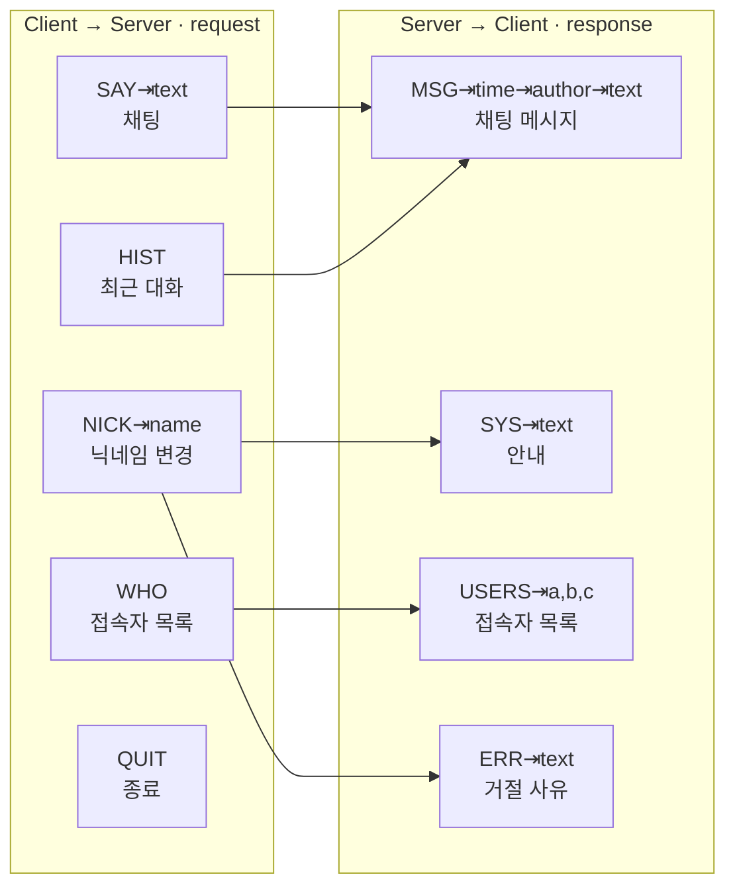

| 방향 | 형식 |
|---|---|
| Client → Server | `SAY<TAB>text` · `NICK<TAB>name` · `WHO` · `HIST` · `QUIT` |
| Server → Client | `MSG<TAB>time<TAB>author<TAB>text` · `SYS<TAB>text` · `USERS<TAB>a,b,c` · `ERR<TAB>text` |

## 요구 사항

- OCaml 5.x (opam) — 표준 배포판의 `unix`, `threads`만 사용, 추가 패키지 불필요
- Windows: `winget install OCaml.opam` → `opam init`

## 빌드

```powershell
.\build.ps1
```

`bin\server.exe`, `bin\client.exe`(네이티브)와 `bin\server.byte`, `bin\client.byte`(바이트코드)가 생성됩니다.
중간 파일은 `_build\`에 생깁니다.

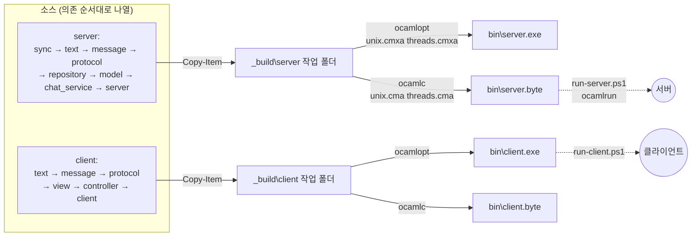

> OCaml은 모듈을 **사용 전에** 컴파일해야 하므로 `build.ps1`의 소스 목록은 의존 순서를 지켜야 합니다. 새 모듈을 추가하면 이 목록에 알맞은 위치로 넣으세요.

## 실행

```powershell
.\run-server.ps1                     # 서버 (기본 포트 9000)
.\run-client.ps1                     # 클라이언트 — 터미널 여러 개에서 실행
.\run-client.ps1 192.168.0.10 9000   # 다른 PC의 서버에 접속
```

> 일부 백신이 새로 컴파일된 `server.exe`를 오탐할 수 있어 `run-server.ps1`은 바이트코드(`ocamlrun bin\server.byte`)로 실행합니다.

## 명령어

| 입력 | 동작 |
|---|---|
| `/nick NAME` | 닉네임 변경 (영문/숫자/`_`/`-`, 최대 16자, 중복 불가) |
| `/who` | 접속자 목록 |
| `/history` | 최근 메시지 20개 |
| `/quit` | 종료 |
| 그 외 | 채팅 메시지 전송 |

## 실행 예

```
connected to 127.0.0.1:9000
*** Welcome, guest1! Commands: /nick NAME, /who, /history, /quit
*** guest1 is now known as alice
*** guest2 joined the chat
*** guest2 is now known as bob
[03:15:03] alice: Hello bob!
[03:15:03] bob: Hi alice, OCaml chat works
*** online (2): alice, bob
```
