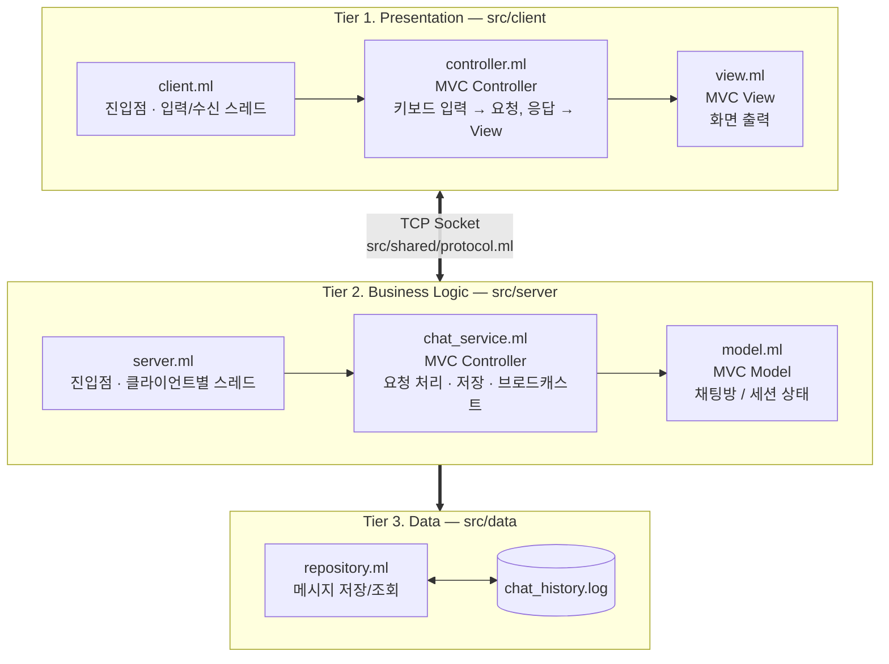
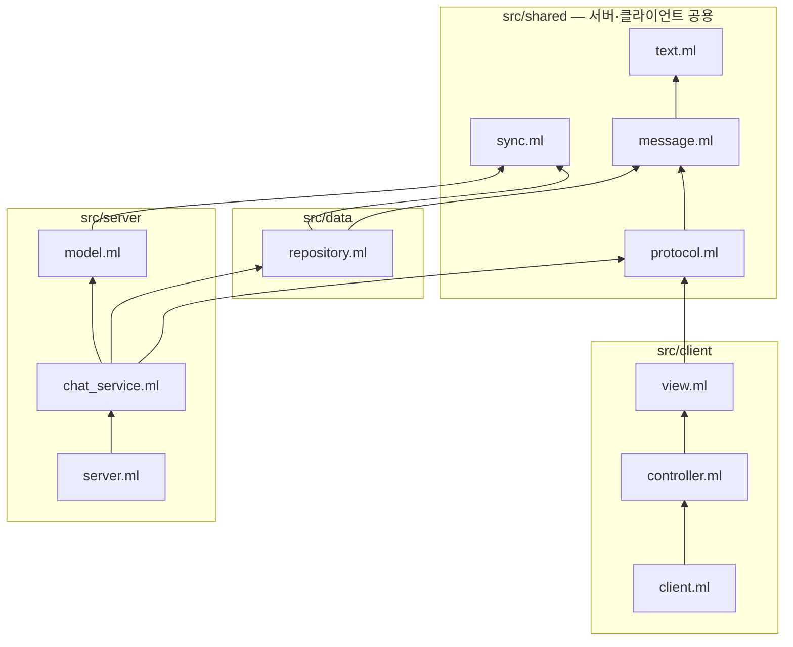
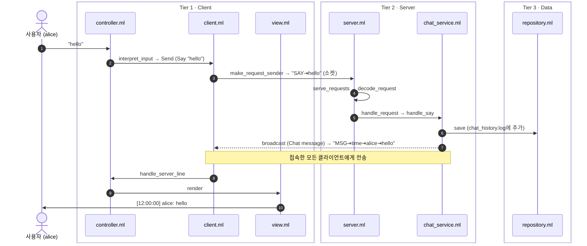
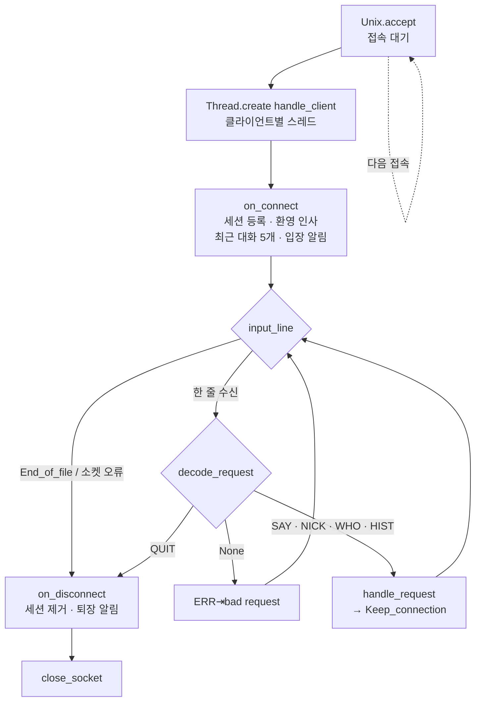
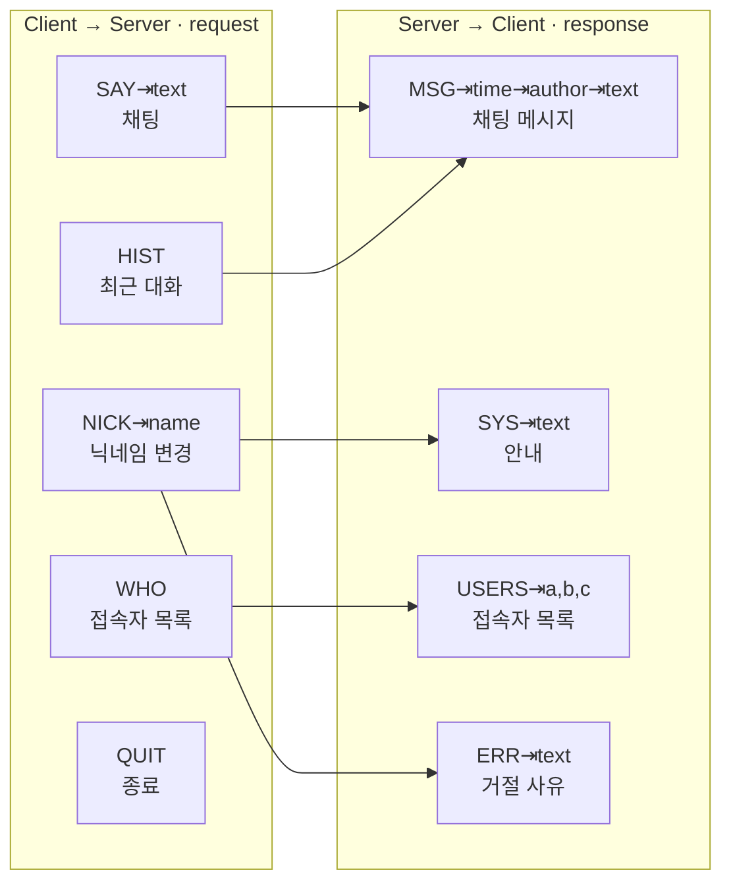

# OCaml Chat

OCaml로 작성한 TCP 소켓 기반 멀티 유저 채팅 프로그램입니다.
**3-Tier 아키텍처**와 **MVC 패턴**으로 구성되어 있으며, 메시지 처리는 모두 서버에서 이루어집니다.

## 아키텍처



### 모듈 의존 관계



> 화살표는 "사용한다" 방향입니다. 빌드 순서는 아래(shared) → 위(server / client)입니다.

## 폴더 구조

```
src/
  shared/              서버·클라이언트 공용
    sync.ml            스레드 잠금 도우미 (with_lock)
    text.ml            문자열 도우미 (탭 필드 분리/결합, BOM·\r 제거)
    message.ml         채팅 메시지 타입 (공용 Model 데이터)
    protocol.ml        소켓 통신 규약 (request / response 인코딩·디코딩)
  data/
    repository.ml      Tier 3 — 메시지 영속화
  server/
    model.ml           Tier 2 — MVC Model
    chat_service.ml    Tier 2 — MVC Controller (메시지 처리)
    server.ml          Tier 2 — 서버 진입점
  client/
    view.ml            Tier 1 — MVC View
    controller.ml      Tier 1 — MVC Controller
    client.ml          Tier 1 — 클라이언트 진입점
build.ps1              빌드 스크립트 → bin/
run-server.ps1         서버 실행
run-client.ps1         클라이언트 실행
```

## 요청 처리 흐름

키보드로 `hello`를 입력했을 때의 흐름입니다.



### 클라이언트 연결 수명 주기 (서버)



## 통신 프로토콜

한 줄 = 메시지 하나, 필드 구분자 = 탭(`⇥`)



| 방향 | 형식 |
|---|---|
| Client → Server | `SAY<TAB>text` · `NICK<TAB>name` · `WHO` · `HIST` · `QUIT` |
| Server → Client | `MSG<TAB>time<TAB>author<TAB>text` · `SYS<TAB>text` · `USERS<TAB>a,b,c` · `ERR<TAB>text` |

## 요구 사항

- OCaml 5.x (opam) — 표준 배포판의 `unix`, `threads`만 사용, 추가 패키지 불필요
- Windows: `winget install OCaml.opam` → `opam init`

## 빌드

```powershell
.\build.ps1
```

`bin\server.exe`, `bin\client.exe`(네이티브)와 `bin\server.byte`, `bin\client.byte`(바이트코드)가 생성됩니다.
중간 파일은 `_build\`에 생깁니다.

## 실행

```powershell
.\run-server.ps1                     # 서버 (기본 포트 9000)
.\run-client.ps1                     # 클라이언트 — 터미널 여러 개에서 실행
.\run-client.ps1 192.168.0.10 9000   # 다른 PC의 서버에 접속
```

> 일부 백신이 새로 컴파일된 `server.exe`를 오탐할 수 있어 `run-server.ps1`은 바이트코드(`ocamlrun bin\server.byte`)로 실행합니다.

## 명령어

| 입력 | 동작 |
|---|---|
| `/nick NAME` | 닉네임 변경 (영문/숫자/`_`/`-`, 최대 16자, 중복 불가) |
| `/who` | 접속자 목록 |
| `/history` | 최근 메시지 20개 |
| `/quit` | 종료 |
| 그 외 | 채팅 메시지 전송 |

## 실행 예

```
connected to 127.0.0.1:9000
*** Welcome, guest1! Commands: /nick NAME, /who, /history, /quit
*** guest1 is now known as alice
*** guest2 joined the chat
*** guest2 is now known as bob
[03:15:03] alice: Hello bob!
[03:15:03] bob: Hi alice, OCaml chat works
*** online (2): alice, bob
```
