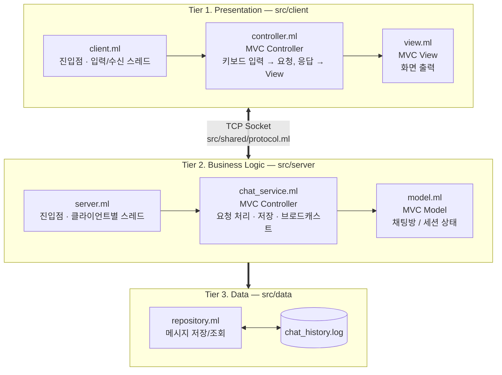
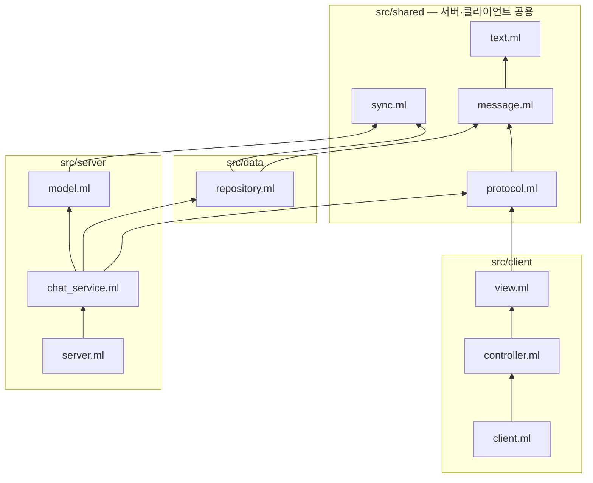
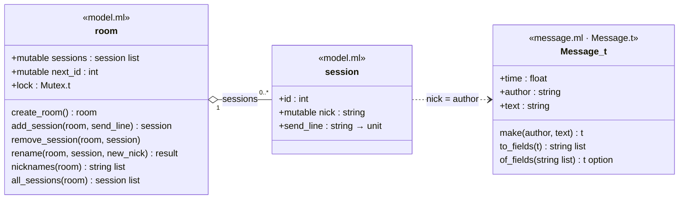
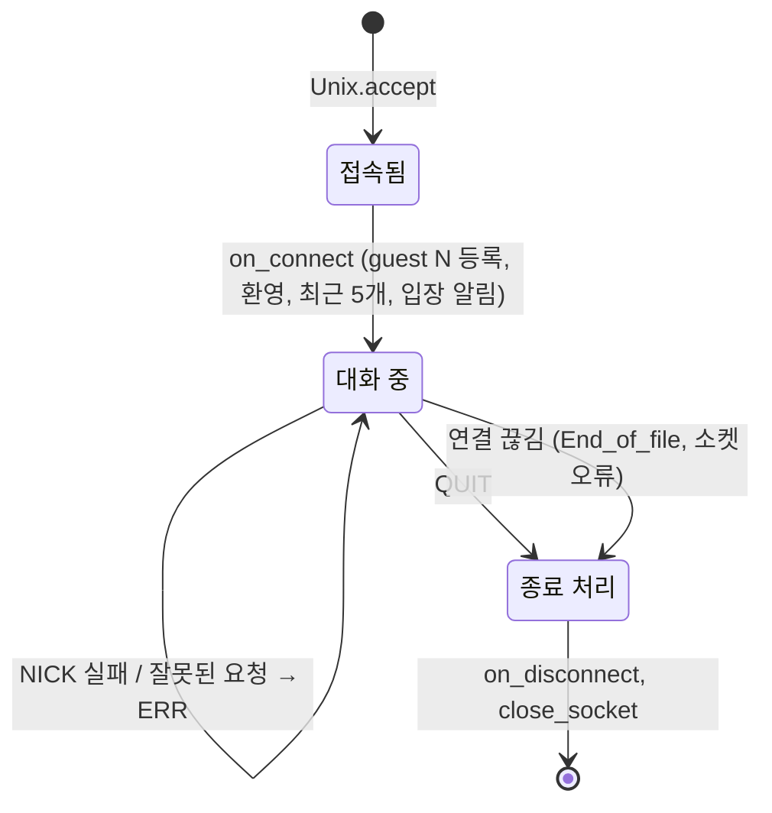

# 아키텍처

[← README](../README.md) · **아키텍처** · [요청 흐름](flows.md) · [동시성](concurrency.md) · [프로토콜](protocol.md) · [빌드 · CI](build.md)

OCaml Chat은 **3-Tier 아키텍처** 위에 **MVC 패턴**을 얹은 구조입니다.
메시지 처리(검증 · 저장 · 전송)는 모두 서버에서 이루어지고, 클라이언트는 입력과 화면 출력만 담당합니다.

## 계층 구조

| 계층 | 폴더 | 역할 | MVC |
|---|---|---|---|
| Tier 1. Presentation | `src/client` | 키보드 입력 해석, 서버 응답 출력 | View · Controller |
| Tier 2. Business Logic | `src/server` | 요청 처리, 상태 관리, 브로드캐스트 | Model · Controller |
| Tier 3. Data | `src/data` | 메시지 영속화 (`chat_history.log`) | — |
| 공용 | `src/shared` | 메시지 타입, 프로토콜, 문자열 · 잠금 도우미 | Model 데이터 |

> Tier 2는 `repository.ml`의 `save` / `load_recent` 두 함수만 사용합니다. 저장소를 DB로 바꿔도 `repository.ml`만 고치면 됩니다.

## 모듈 의존 관계

> 화살표는 "사용한다" 방향입니다. 빌드 순서는 아래(shared) → 위(server / client)입니다. 자세한 내용은 [빌드 · CI](build.md)를 보세요.

## 데이터 모델

서버 상태(`model.ml`)와 공용 메시지 타입(`message.ml`)입니다.

| 규칙 | 내용 |
|---|---|
| 기본 닉네임 | 접속 순서대로 `guest1`, `guest2`, … (`next_id`) |
| 닉네임 형식 | 1~16자, `a-z A-Z 0-9 _ -` |
| 닉네임 중복 | 다른 세션이 쓰는 이름이면 `ERR⇥nickname already in use` |

## 클라이언트 접속 상태

