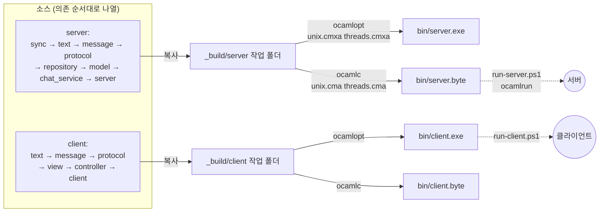
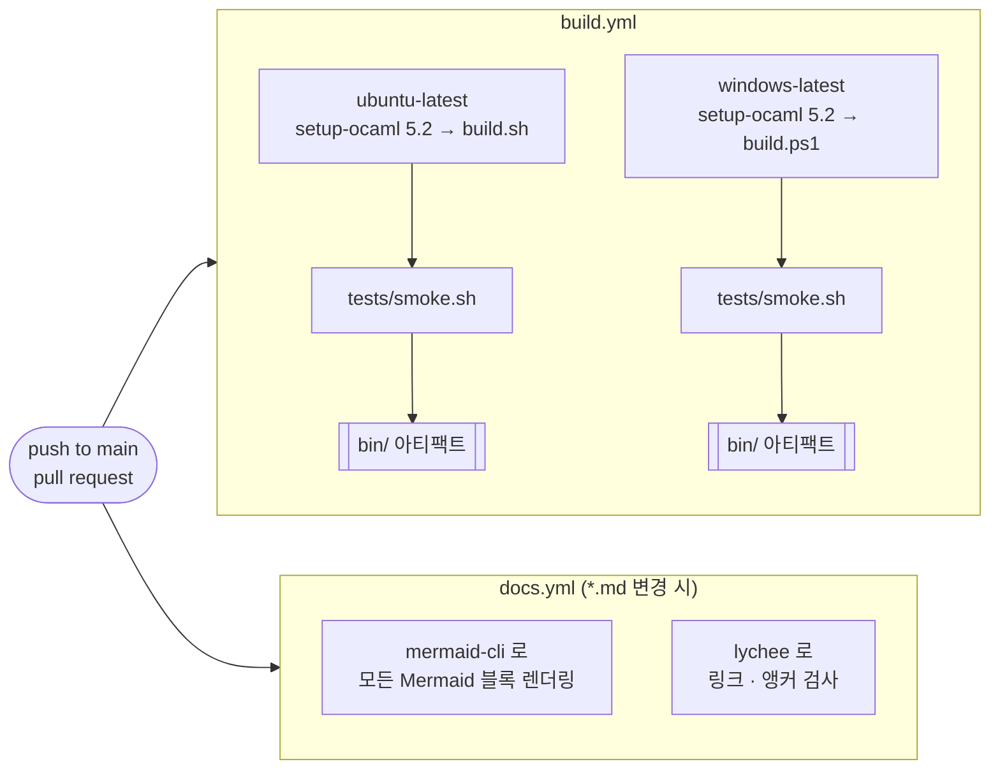

# 빌드 · CI

[← README](../README.md) · [아키텍처](architecture.md) · [요청 흐름](flows.md) · [동시성](concurrency.md) · [프로토콜](protocol.md) · **빌드 · CI**

## 요구 사항

- OCaml 5.x (opam) — 표준 배포판의 `unix`, `threads`만 사용, 추가 패키지 불필요
- Windows: `winget install OCaml.opam` → `opam init`
- Linux / macOS: 배포판의 `opam` 설치 → `opam init`

## 빌드 스크립트

| OS | 명령 | 비고 |
|---|---|---|
| Windows | `.\build.ps1` | opam 내부 Cygwin의 mingw gcc를 PATH에 추가 |
| Linux / macOS / Git Bash | `./build.sh` | opam이 있으면 `opam exec --`, 없으면 PATH의 컴파일러 사용 |

두 스크립트 모두 같은 결과를 만듭니다.

| 파일 | 종류 | 실행 |
|---|---|---|
| `bin/server.exe`, `bin/client.exe` | 네이티브 (`ocamlopt`) | 직접 실행 |
| `bin/server.byte`, `bin/client.byte` | 바이트코드 (`ocamlc`) | `ocamlrun bin/server.byte` |

중간 파일(`.cmi` `.cmx` `.o` …)은 `_build/`에 생기므로 `src/`는 깨끗하게 유지됩니다.

## 빌드 흐름



> OCaml은 모듈을 **사용 전에** 컴파일해야 하므로 소스 목록은 의존 순서를 지켜야 합니다.
> 새 모듈을 추가하면 `build.ps1`과 `build.sh` **두 곳 모두** 알맞은 위치에 넣으세요.

## 스모크 테스트

`tests/smoke.sh`는 서버를 띄우고 클라이언트에 정해진 입력을 넣어 화면 출력을 검사합니다.
대화 기록은 임시 폴더에 쓰므로 저장소의 `chat_history.log`를 건드리지 않습니다.

```sh
./build.sh          # 또는 .\build.ps1
./tests/smoke.sh    # Windows 에서는 Git Bash 로 실행
```

| 입력 | 기대 출력 |
|---|---|
| (접속) | `*** Welcome, guest1!` |
| `/nick bad name!` | `!!! invalid nickname …` |
| `/nick alice` | `*** guest1 is now known as alice` |
| `hello smoke` | `[HH:MM:SS] alice: hello smoke` |
| `/who` | `*** online (1): alice` |
| `/history` | `*** ---- last messages ----` |
| `/quit` | `*** disconnected from server` |

## CI (GitHub Actions)



| 워크플로 | 실행 조건 | 검사 내용 |
|---|---|---|
| `build.yml` | `main` 푸시, 모든 PR | Linux · Windows 빌드, 스모크 테스트, 바이너리 업로드 |
| `docs.yml` | `*.md` 변경 시 | Mermaid 문법(렌더링 성공 여부), 깨진 링크 · 목차 앵커 |
