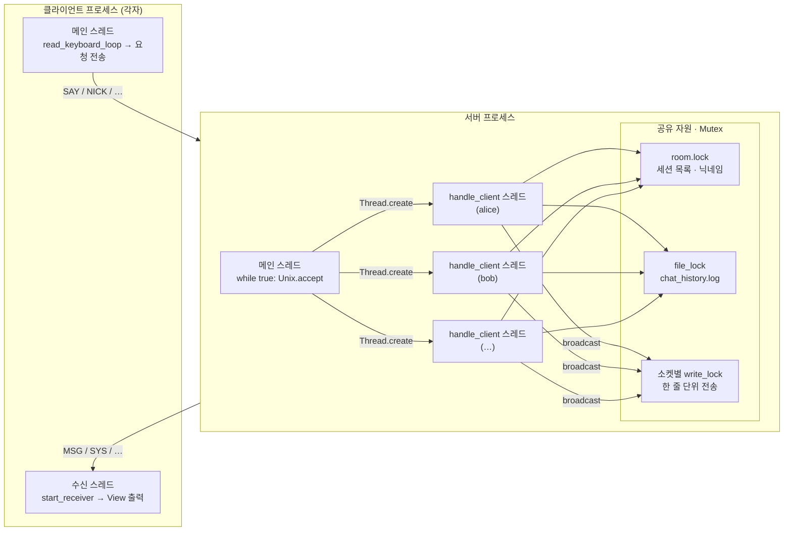

# 스레드와 동시성

[← README](../README.md) · [아키텍처](architecture.md) · [요청 흐름](flows.md) · **동시성** · [프로토콜](protocol.md) · [빌드 · CI](build.md)

서버는 접속마다 스레드를 하나씩 띄우고, 공유 자원은 `Sync.with_lock`으로 보호합니다.
`with_lock`은 `Fun.protect ~finally`로 감싸져 있어 작업 중 예외가 나도 잠금이 반드시 풀립니다.

## 스레드 구성



## 잠금 정리

| 잠금 | 위치 | 보호 대상 | 이유 |
|---|---|---|---|
| `room.lock` | `model.ml` | 세션 목록, 닉네임, `next_id` | 동시 접속·닉 변경 시 목록 일관성 |
| `file_lock` | `repository.ml` | `chat_history.log` 쓰기/읽기 | 저장 중 읽기 · 줄 섞임 방지 |
| `write_lock` | `server.ml` (소켓마다) | 소켓 출력 채널 | 여러 스레드의 broadcast가 한 소켓에 겹쳐 쓰는 것 방지 |

## 브로드캐스트는 잠금 밖에서

```mermaid
sequenceDiagram
    participant T as handle_client 스레드
    participant M as model.ml (room.lock)
    participant S1 as 소켓 A (write_lock)
    participant S2 as 소켓 B (write_lock)

    T->>M: all_sessions room
    Note over M: 잠금 안에서 목록 복사본만 반환
    M-->>T: [A; B]
    Note over T: room.lock 해제된 상태로 전송
    T->>S1: send_line "MSG⇥…"
    T->>S2: send_line "MSG⇥…"
    Note over S2: 끊긴 소켓이면 예외를 무시하고 계속
```

잠금을 잡은 채 소켓에 쓰면 느린 클라이언트 하나가 채팅방 전체를 막습니다.
그래서 `broadcast`는 `all_sessions`로 세션 목록 **복사본**만 잠금 안에서 얻고, 실제 전송은 잠금 밖에서 합니다.

## 클라이언트 종료 처리

- 입력 끝(`Ctrl+Z` / `Ctrl+D`)이나 `/quit` → 메인 스레드가 `QUIT`을 보내고 입력 반복을 멈춥니다.
- 서버가 연결을 닫으면 수신 스레드가 `View.show_disconnected`를 출력하고 `exit 0`으로 프로세스 전체를 끝냅니다.
- 메인 스레드는 `Thread.join receiver`로 서버가 연결을 닫을 때까지 기다립니다.
