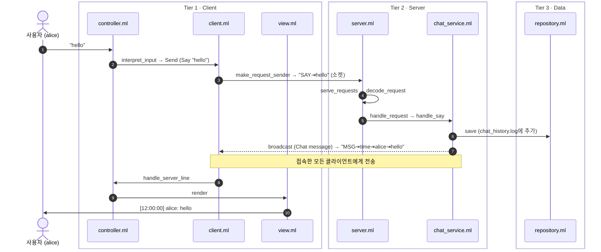
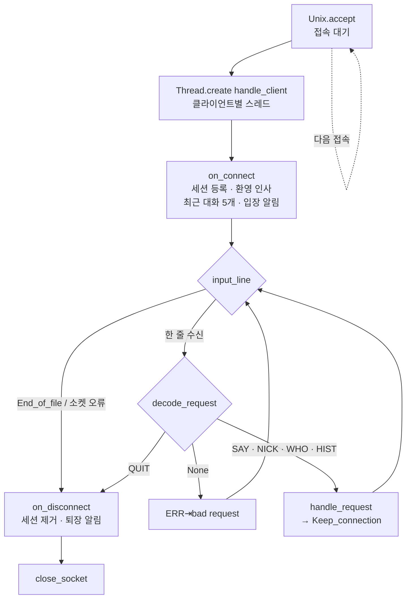
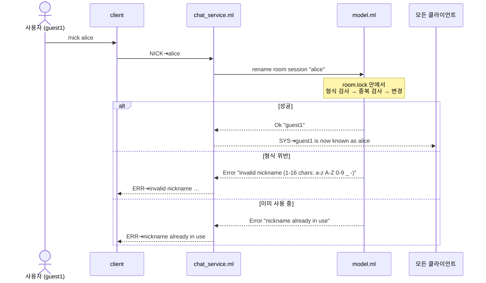
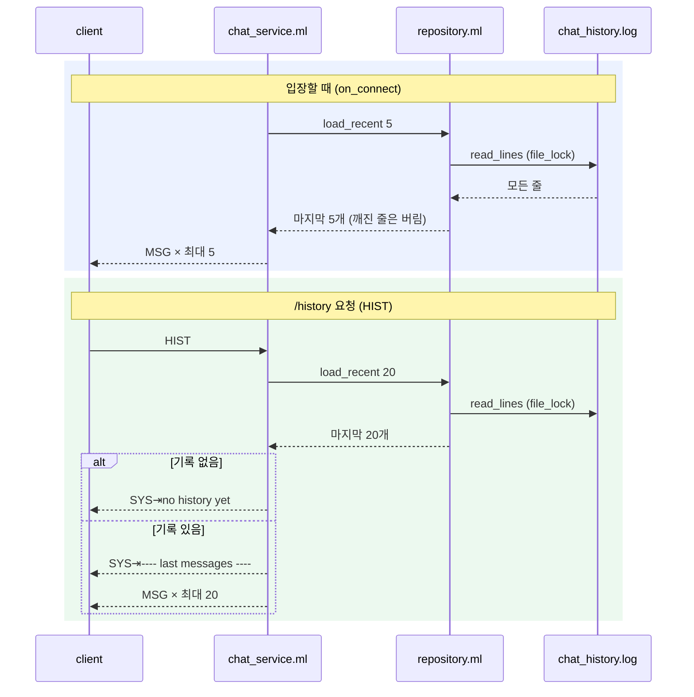

# 요청 처리 흐름

[← README](../README.md) · [아키텍처](architecture.md) · **요청 흐름** · [동시성](concurrency.md) · [프로토콜](protocol.md) · [빌드 · CI](build.md)

## 채팅 메시지 (`SAY`)

키보드로 `hello`를 입력했을 때의 흐름입니다.

빈 메시지(공백만 있는 줄)는 `handle_say`에서 무시되고 저장 · 전송하지 않습니다.

## 클라이언트 연결 수명 주기 (서버)

## 닉네임 변경 (`/nick`)

`/nick`만 입력하고 이름을 비우면 서버로 보내지 않고 클라이언트에서 도움말을 출력합니다.

## 대화 기록 (입장 시 · `/history`)

저장 형식은 [프로토콜](protocol.md#저장-형식)을 보세요.
