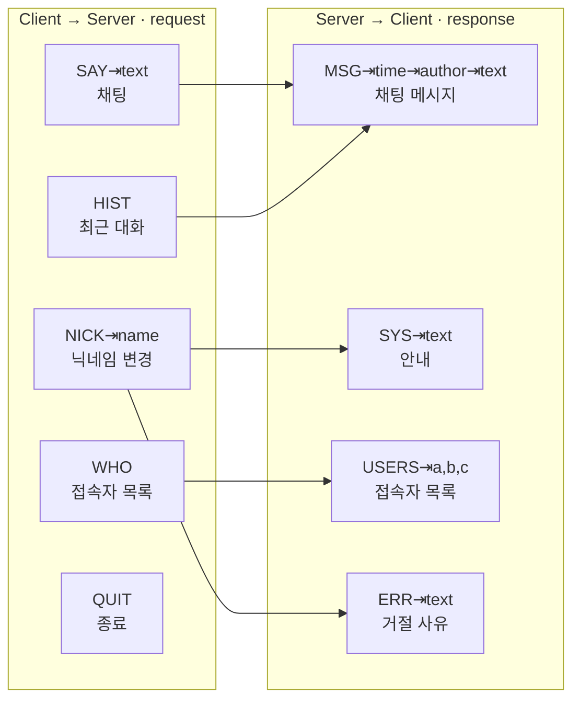

# 통신 프로토콜

[← README](../README.md) · [아키텍처](architecture.md) · [요청 흐름](flows.md) · [동시성](concurrency.md) · **프로토콜** · [빌드 · CI](build.md)

TCP 위의 줄 단위 텍스트 프로토콜입니다. 정의는 `src/shared/protocol.ml` 한 곳에 있고 서버와 클라이언트가 함께 씁니다.

- 한 줄 = 메시지 하나 (`\n`으로 끝남)
- 필드 구분자 = 탭 (`⇥`, `\t`)
- 보내기 전에 `Text.sanitize`로 본문 안의 탭 · 줄바꿈을 제거하므로 필드가 섞이지 않습니다.

## 요청 → 응답



## 요청 (Client → Server)

| 줄 | OCaml 값 (`request`) | 클라이언트 입력 | 응답 | 받는 사람 |
|---|---|---|---|---|
| `SAY⇥text` | `Say text` | 일반 텍스트 | `MSG` | 전원 |
| `NICK⇥name` | `Change_nick name` | `/nick NAME` | `SYS` (성공) / `ERR` (실패) | 전원 / 본인 |
| `WHO` | `List_users` | `/who` | `USERS` | 본인 |
| `HIST` | `Show_history` | `/history` | `SYS` + `MSG` × 최대 20 | 본인 |
| `QUIT` | `Quit` | `/quit`, 입력 끝 | (연결 종료, 남은 사람에게 퇴장 `SYS`) | — |
| 그 외 | `None` | — | `ERR⇥bad request` | 본인 |

## 응답 (Server → Client)

| 줄 | OCaml 값 (`response`) | 화면 출력 예 |
|---|---|---|
| `MSG⇥time⇥author⇥text` | `Chat message` | `[12:00:00] alice: hello` |
| `SYS⇥text` | `Notice text` | `*** bob joined the chat` |
| `USERS⇥a,b,c` | `User_list names` | `*** online (2): alice, bob` |
| `ERR⇥text` | `Rejected reason` | `!!! nickname already in use` |

`time`은 Unix epoch 초(정수 문자열)이고, 화면에는 클라이언트의 현지 시각 `HH:MM:SS`로 출력됩니다.

## 저장 형식

`chat_history.log`는 `MSG`의 필드와 같은 형식을 씁니다 (`Message.to_fields` / `of_fields` 공용).

```
1794937352⇥alice⇥hello
1794937360⇥bob⇥hi alice
```

형식이 깨진 줄은 읽을 때 건너뜁니다.

## 직접 접속해 보기

줄 단위 텍스트이므로 `ncat` 같은 도구로도 대화할 수 있습니다 (탭은 직접 입력).

```
$ ncat 127.0.0.1 9000
SYS	Welcome, guest3! Commands: /nick NAME, /who, /history, /quit
WHO
USERS	alice,bob,guest3
```
